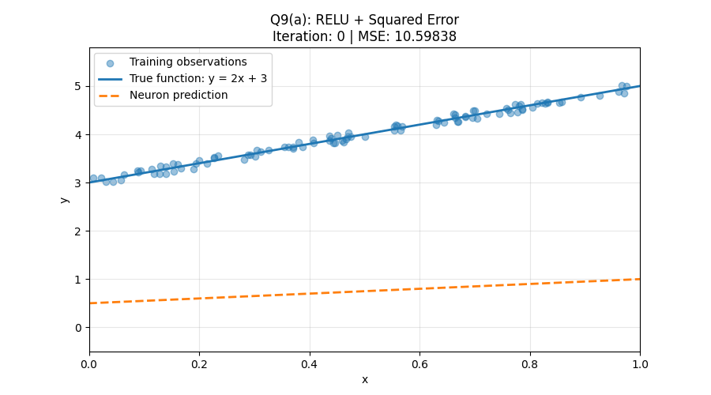

# Homework 3 — Perceptrons and Neural Networks

**Course:** CS6220 — Data Mining Techniques  
**University:** Northeastern University  
**Student:** Mihir Mathur  
**NUID:** 002535005

## Overview

This repository folder contains the Jupyter notebooks, visualizations, and experimental results for Homework 3.

The implementation covers k-nearest neighbors (k-NN), perceptron training, neuron activation functions, loss functions, and gradient flow in multilayer neural networks.

## Files

| File | Description |
|---|---|
| `homework_3_002535005.ipynb` | Main homework notebook containing implementations, experiments, plots, and explanations. |
| `HW3-gradient_flow_mnist.ipynb` | MNIST neural network experiments analyzing gradient flow across layers. |
| `Q9_ReLU_Training.gif` | Animated visualization of ReLU neuron training using squared error. |
| `requirements.txt` | Python dependencies required to run the notebooks. |

## Question 9: ReLU Training Animation

The animation below demonstrates how a ReLU neuron learns to approximate the target function \(y = 2x + 3\) using squared error.



[View the ReLU Training Animation](Q9_ReLU_Training.gif)

## Running the Notebooks

1. Clone the repository.
2. Navigate to the `Homework-3` directory.
3. Install the required dependencies:

   ```bash
   python -m pip install -r requirements.txt
   ```

4. Launch Jupyter Notebook:

   ```bash
   jupyter notebook
   ```

5. Open either notebook and execute its cells in order.

**Note:** The MNIST notebook uses PyTorch and torchvision. Its dataset may be downloaded automatically when executed, requiring an internet connection on the first run.

## Reproducibility

The notebooks contain the source code and saved visualizations for the homework experiments. Some animations require executing the corresponding notebook cells to regenerate interactive outputs.

The ReLU training animation is also provided as a separate GIF for convenient viewing on GitHub.
