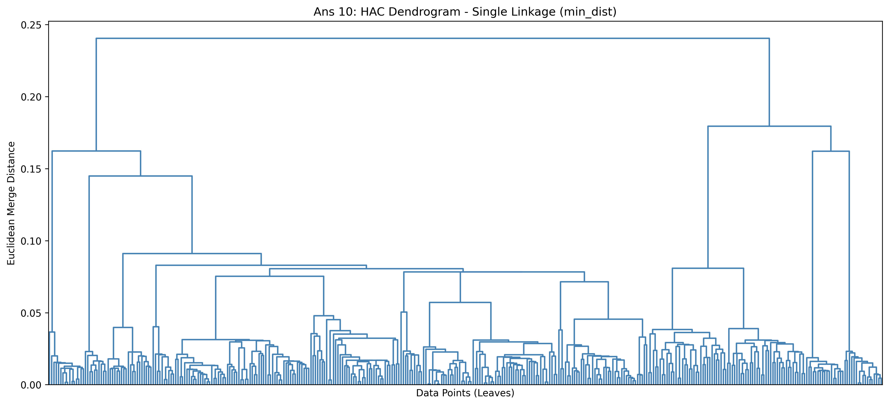
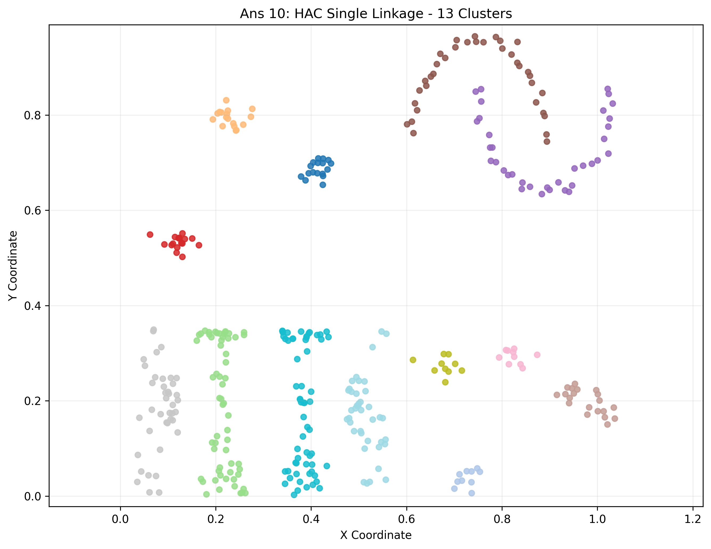
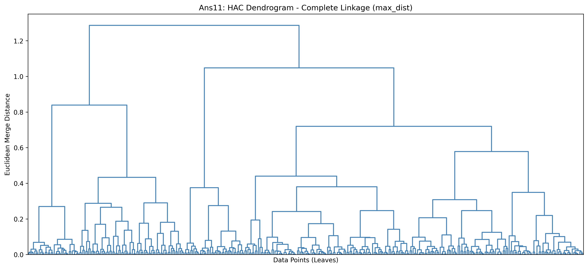
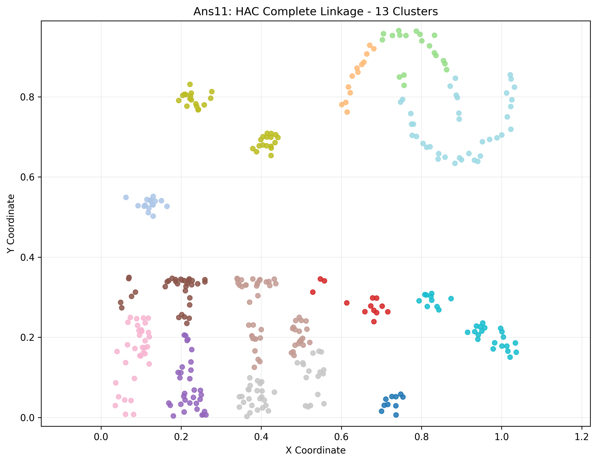
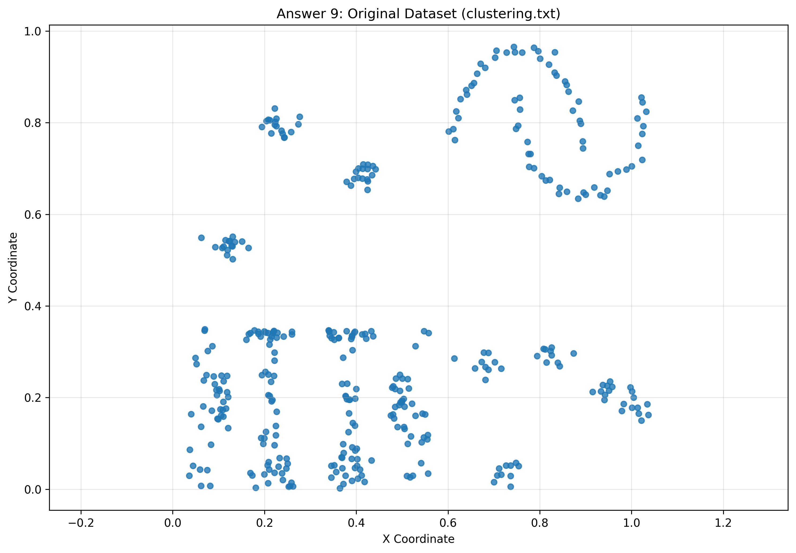

# Homework 4 — Association Rule Mining and Hierarchical Clustering

**Course:** CS6220 — Data Mining Techniques  
**University:** Northeastern University  
**Student:** Mihir Mathur

## Overview

This repository folder contains the Jupyter Notebook, dataset, and visualizations for Homework 4.

The assignment covers two major data mining techniques:

1. Frequent Itemset Mining and Association Rule Generation
2. Hierarchical Agglomerative Clustering (HAC)

The implementations emphasize Apriori-based pruning, confidence-based association rule generation, and efficient incremental distance updates for hierarchical clustering.

## Part 1: Frequent Itemset Mining

Implemented the Apriori algorithm using:

- Support calculation
- Candidate generation (JOIN)
- Subset-based pruning (PRUNE)
- Support counting (COUNT)
- Frequent itemset discovery

**Parameters:**
- Transactions: 20
- Minimum support: 0.25

**Results:**

| Itemset Size | Frequent Itemsets | Subset-Pruned Candidates |
|---|---:|---:|
| 1 | 5 | 0 |
| 2 | 4 | 0 |
| 3 | 1 | 2 |
| 4 | 0 | 0 |

At k = 3, subset pruning eliminated 2 of 3 candidates, reducing support evaluations by 66.67%.

## Part 2: Association Rule Mining

Implemented Apriori_rules using confidence-based candidate generation and pruning.

**Parameters:**
- Minimum support: 0.25
- Minimum confidence: 0.60

**Results:**
- 11 qualifying association rules
- Confidence and lift calculated for every rule
- No duplicate rules

**Example strong rule:**

{Bread, Milk} → {Butter}

- Support: 0.25
- Confidence: 1.00
- Lift: 3.3333

## Part 3: Hierarchical Agglomerative Clustering

Implemented HAC supporting two cluster-distance functions:

- `min_dist`: Single linkage
- `max_dist`: Complete linkage

The implementation uses incremental distance-matrix updates instead of recomputing all pairwise cluster distances after each merge.

**Dataset:** `clustering.txt`

- 370 two-dimensional points
- 369 merges for a complete dendrogram
- 13 target clusters
- 357 merges to obtain 13 clusters

### Single Linkage (min_dist)

Single linkage preserves elongated and curved structures and more closely matches the visual intuition for this dataset.

### Complete Linkage (max_dist)

Complete linkage favors compact clusters and may divide elongated structures into smaller groups.

## Dataset Visualization

The original dataset was visualized before applying clustering.

## Repository Files

- `homework_4.ipynb` — Complete Python implementations and results
- `clustering.txt` — Two-dimensional clustering dataset
- `Q9_dataset_scatter.png` — Original dataset visualization
- `Q10_single_linkage_dendrogram.png` — Single-linkage dendrogram
- `Q10_single_linkage_13_clusters.png` — Single-linkage cluster visualization
- `Ans11_complete_linkage_dendrogram.png` — Complete-linkage dendrogram
- `Ans11_complete_linkage_13_clusters.png` — Complete-linkage cluster visualization
- `requirements.txt` — Python dependencies

## Installation and Execution

1. Clone the repository:

   git clone https://github.com/mihir1mathur/CS6220-Data-Mining.git

2. Navigate to Homework-4:

   cd CS6220-Data-Mining/Homework-4

3. Install dependencies:

   python -m pip install -r requirements.txt

4. Start Jupyter:

   jupyter lab

5. Open `homework_4.ipynb` and run all cells sequentially.

Keep `clustering.txt` in the same directory as the notebook.

## Technologies

- Python
- NumPy
- Matplotlib
- SciPy
- Jupyter Notebook

## Key Learning Outcomes

- Apriori frequent itemset mining
- Support, confidence, and lift
- Candidate generation and pruning
- Efficient association rule generation
- Hierarchical agglomerative clustering
- Single and complete linkage
- Incremental distance updates
- Dendrogram construction and cluster visualization
